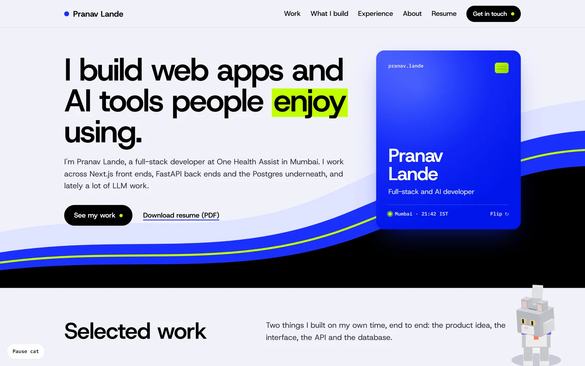
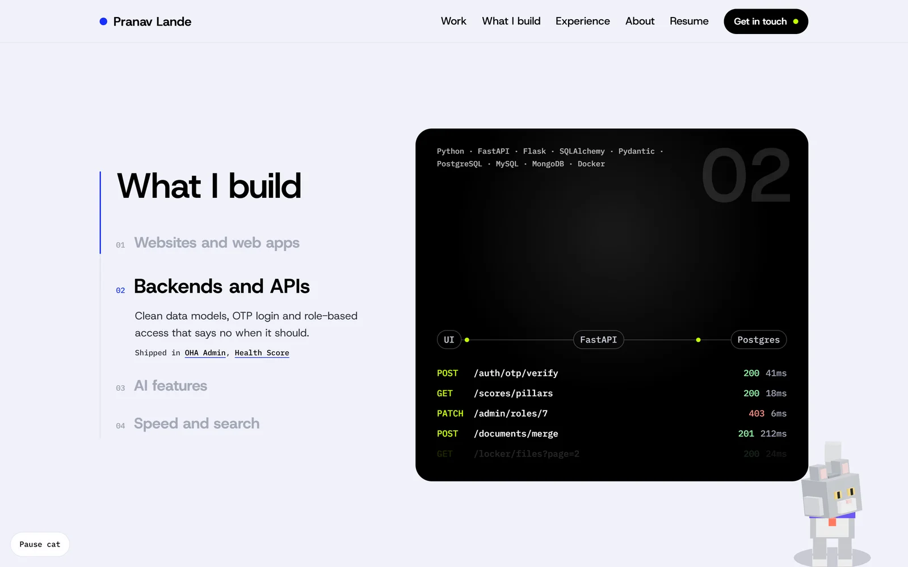
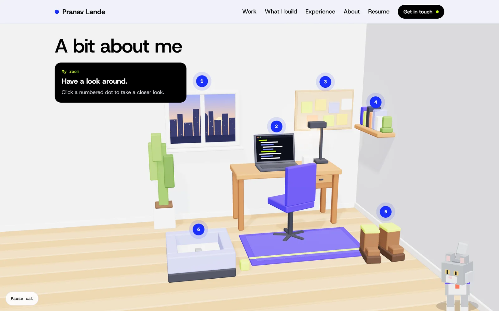
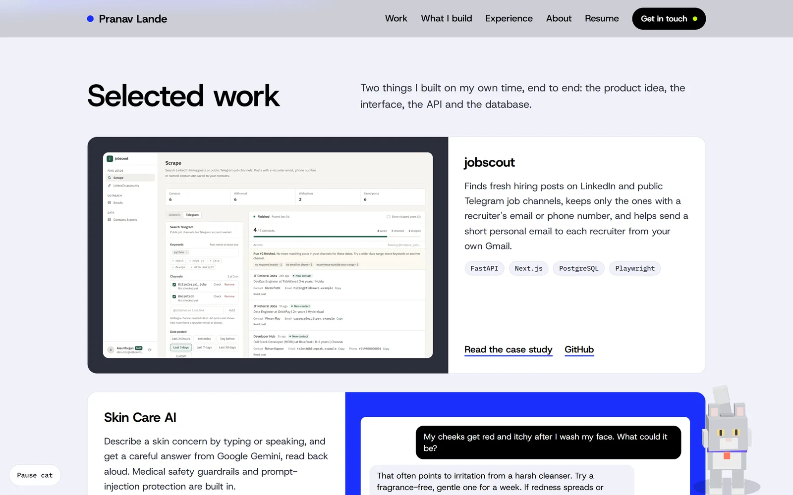
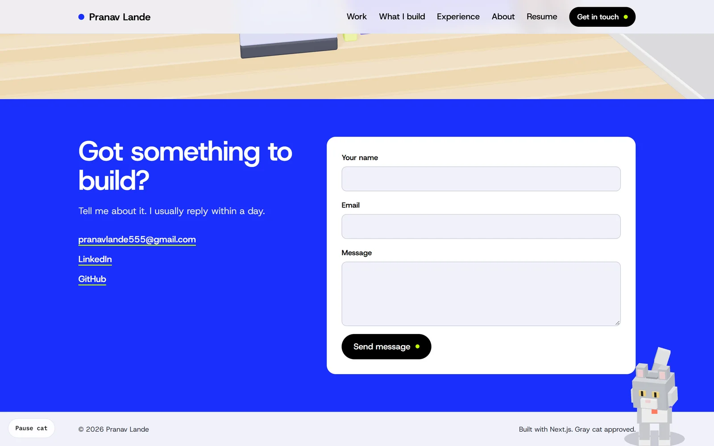
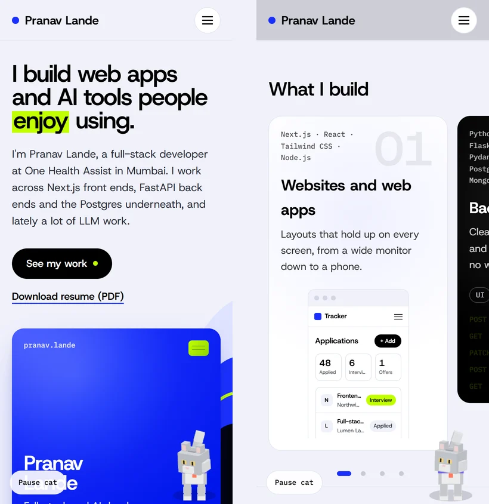

<div align="center">

# Pranav Lande · Portfolio

**Personal portfolio of Pranav Lande, full-stack and AI developer in Mumbai.**
Hand-built with Next.js and three.js, backed by a small FastAPI + PostgreSQL service.

**[Live site: pranavportfolio-dev.vercel.app](https://pranavportfolio-dev.vercel.app/)**




</div>

## Highlights

- **3D business card.** The hero card flips on click to a code-editor view of `pranav.py`, over layered animated waves.
- **"What I build" story.** On desktop the section pins while you scroll and swaps between four live demos (a responsive app, an API request log, an AI chat and a page-speed checklist). On phones it becomes a swipeable carousel.
- **Voxel room.** "A bit about me" is a full-screen three.js room with numbered hotspots; the camera flies to each object. Desktop and tablet only, so phones never load the scene.
- **Simbha, the site's cat.** A voxel gray cat lives in the corner: he walks, peeks, chases a mouse he never catches, and has opinions when you click him. Visitors can pause him.
- **Paper-plane contact form.** On send, the form crumples into a 3D paper ball, lands on a paper plane and flies off leaving a white wave trail. If sending fails, the paper smooths back into the form with nothing lost.
- **Real backend.** Messages are validated, rate-limited, stored in PostgreSQL and emailed on through Resend.
- **Built to be found and used.** Metadata, Person structured data, sitemap, share images, keyboard and screen-reader support, and `prefers-reduced-motion` respected throughout.

## Screenshots

| What I build | A bit about me |
|---|---|
|  |  |
| **Selected work** | **Contact** |
|  |  |

<p align="center"></p>

## Tech stack

| Area | Tools |
|---|---|
| Frontend | Next.js 16 (App Router), React 19, JavaScript, Tailwind CSS 4 |
| 3D and motion | three.js, Lenis smooth scrolling, CSS and canvas animation |
| Backend | Python, FastAPI, psycopg 3 with a connection pool, Pydantic settings |
| Database | PostgreSQL |
| Email | Resend API |
| Testing | Vitest + Testing Library, Playwright, pytest |

## How it fits together

```
Browser ── Next.js site (static pages, three.js scenes)
              │
              │ POST /api/contact  (same domain on Vercel)
              ▼
          FastAPI service ── validates, drops honeypot bots, rate-limits per visitor
              │
              ├── PostgreSQL   every message is stored first
              └── Resend       then emailed on; a failed email never loses a message
```

## Project structure

```
.
├── src/
│   ├── app/            # layout, page, metadata, sitemap, robots, icons, share image
│   ├── components/     # one folder per section: hero, work, build, experience, about, contact, cat, layout, ui
│   ├── content/        # all site copy and data in one place (siteContent.js, siteMetadata.js)
│   ├── hooks/          # small shared React hooks
│   └── three/          # three.js models and animations (cat, room, paper plane)
├── backend/
│   ├── app/            # FastAPI app: settings, database, contact schema, routes, email
│   └── tests/          # pytest suite against a real test database
├── tests/
│   ├── unit/           # Vitest component and logic tests
│   └── e2e/            # Playwright smoke test
└── public/             # project screenshot and resume PDF
```

## Getting started

**Requirements:** Node.js 20.9+, Python 3.12+, [uv](https://docs.astral.sh/uv/), PostgreSQL.

```bash
# 1. Site, http://localhost:3000
npm install
npm run dev

# 2. Backend, http://localhost:8000/api
cd backend
cp .env.example .env      # fill in the database URL and other values
createdb portfolio        # plus portfolio_test for the backend tests
uv sync
uv run uvicorn app.main:app --reload --port 8000
```

The contact form works once both are running. See [`backend/README.md`](backend/README.md) for backend details.

## Environment variables

| Variable | Used by | Purpose |
|---|---|---|
| `NEXT_PUBLIC_SITE_URL` | site | Public address for canonical links, sitemap and share images |
| `NEXT_PUBLIC_API_URL` | site | Backend address: `/api` on Vercel, defaults to `http://localhost:8000/api` locally |
| `DATABASE_URL` / `TEST_DATABASE_URL` | backend | PostgreSQL connections for the app and its tests |
| `ALLOWED_ORIGINS` | backend | Sites allowed to call the API, as a JSON list |
| `IP_HASH_SALT` | backend | Salt for hashing visitor IPs used in rate limiting |
| `MESSAGES_PER_HOUR_LIMIT` | backend | Messages allowed per visitor per hour (default 5) |
| `RESEND_API_KEY`, `CONTACT_FROM_EMAIL`, `CONTACT_INBOX_EMAIL` | backend | Email delivery; leave the key empty to only store messages |

## Scripts and tests

| Command | What it does |
|---|---|
| `npm run dev` | Start the site in development mode |
| `npm run build` / `npm start` | Production build and server |
| `npm run lint` | ESLint |
| `npm test` | Unit tests (Vitest) |
| `npm run test:e2e` | Browser tests (Playwright) |
| `cd backend && uv run pytest` | Backend tests |

## Deployment

The repo deploys to **Vercel as one project with two services** (see [`vercel.json`](vercel.json)): the Next.js site at `/` and the FastAPI backend at `/api`, on the same domain.

1. Import the repo in Vercel; it reads `vercel.json` and builds both services.
2. Add a PostgreSQL database (for example Neon from Vercel's Storage tab) and connect it, so `DATABASE_URL` is set. The table is created on first start.
3. Set environment variables: `IP_HASH_SALT`, `NEXT_PUBLIC_API_URL=/api`, `NEXT_PUBLIC_SITE_URL=https://<your domain>`, and optionally the `RESEND_*` email settings.
4. Deploy. On Vercel the backend reads the visitor's address from Vercel's `x-vercel-forwarded-for` header for rate limiting.

Hosting the backend elsewhere also works: point `NEXT_PUBLIC_API_URL` at it, add the site's address to `ALLOWED_ORIGINS`, and behind a proxy start uvicorn with `--proxy-headers --forwarded-allow-ips="*"`.

## Contact

[pranavlande555@gmail.com](mailto:pranavlande555@gmail.com) · [LinkedIn](https://www.linkedin.com/in/pranavlande) · [GitHub](https://github.com/pranoww)

---

© 2026 Pranav Lande. All rights reserved.
